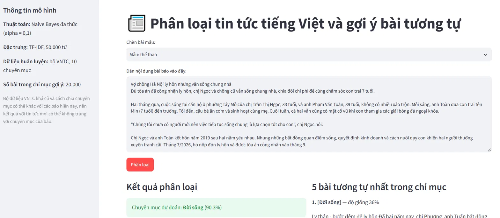

# Phân loại tin tức tiếng Việt và gợi ý bài viết tương tự

Bài tập lớn môn **Nhập môn trí tuệ nhân tạo** (mục 5b: xây dựng mô hình phân loại tài liệu và demo dự đoán tài liệu mới)
Học viện Công nghệ Bưu chính Viễn thông (PTIT) · Giảng viên hướng dẫn: **TS. Nguyễn Thị Tuyết Hải**

## Nhóm thực hiện: K24DTCN417

| Họ và tên | MSSV | Vai trò |
|---|---|---|
| Lê Duy Tuệ | K24DTCN421 | Trưởng nhóm |
| Nguyễn Thị Thuý Quỳnh | K24DTCN417 | Thành viên |
| Khổng Hữu Toàn | K24DTCN420 | Thành viên |

## Giới thiệu

Hệ thống nhận một bài báo tiếng Việt, dự đoán **chuyên mục** (10 chuyên mục) kèm xác suất và gợi ý **5 bài viết tương tự**.

- **Dữ liệu:** bộ VNTC, 84.128 bài báo dùng được (sau khi lọc bài quá ngắn), 10 chuyên mục.
- **Tiền xử lý:** chữ thường, bỏ số và dấu câu, tách từ tiếng Việt bằng `pyvi`, loại từ dừng.
- **Biểu diễn:** TF-IDF, 50.000 đặc trưng.
- **Thuật toán:** Naive Bayes, kNN (độ đo cosine), cây quyết định; khảo sát thêm chọn đặc trưng chi-square.
- **Giao diện:** web Streamlit.



## Kết quả

Chia dữ liệu phân tầng, cố định `random_state = 42`: train 53.841 / validation 13.461 / test 16.826 bài.
Tham số chọn trên tập validation; mô hình cuối huấn luyện lại trên train + validation và chấm **một lần** trên tập test.

| Mô hình | Accuracy | Macro-F1 |
|---|---|---|
| Naive Bayes cơ bản (alpha = 1,0) | 0,8728 | 0,8443 |
| **Naive Bayes tinh chỉnh (alpha = 0,1, tiên nghiệm đều)** | **0,8957** | **0,8855** |
| Naive Bayes tinh chỉnh + chi-square (10.000 đặc trưng) | 0,8927 | 0,8822 |
| kNN, cosine (k = 11) | 0,8565 | 0,8364 |
| Cây quyết định (2.000 đặc trưng, độ sâu 40) | 0,7488 | 0,7307 |

Một số nhận xét:

- Chỉ cần giảm alpha và dùng tiên nghiệm đều, Macro-F1 tăng 4,1 điểm phần trăm và Recall của chuyên mục nhỏ nhất (Khoa học) tăng từ 0,375 lên 0,765.
- Chọn đặc trưng chi-square không làm tăng độ chính xác, nhưng mô hình nhỏ hơn 5 lần mà chỉ kém khoảng 0,3 điểm.
- kNN dự đoán chậm hơn Naive Bayes hơn một nghìn lần (74 giây so với 0,04 giây cho 16.826 bài).

### Thử trên 30 bài báo thật (ngoài bộ dữ liệu)

Nhóm tự thu thập 30 bài báo mới (3 bài mỗi chuyên mục) và gán nhãn theo mục của báo:

| Chỉ số | Kết quả |
|---|---|
| Top-1 (dự đoán đầu tiên đúng) | 15/30 = 50% |
| Top-2 (nhãn thật nằm trong 2 dự đoán đầu) | 24/30 = 80% |

Mẫu chỉ có 30 bài nên khoảng tin cậy rộng; kết quả cho thấy hiệu năng giảm khi dữ liệu khác thời kỳ và khác cách phân mục so với VNTC. Chi tiết trong báo cáo.
Thư mục `external_test/` (các bài báo gốc) **không** được đưa lên repository vì vấn đề bản quyền; chỉ lưu kết quả trong `images/ket_qua_ngoai_mien.csv`.

## Chạy demo

Mô hình đã huấn luyện có sẵn trong `model/demo_model.pkl`, nên chạy demo không cần tải dữ liệu.

```bash
pip install -r requirements.txt
python -m streamlit run app.py
```

Mở trình duyệt tại `http://localhost:8501`, dán nội dung một bài báo (hoặc chọn bài mẫu) rồi bấm **Phân loại**.
Mã nguồn được phát triển và chạy thử trên Windows, Python 3.14. Nếu dùng phiên bản Python hoặc `scikit-learn` khác và gặp lỗi khi nạp `demo_model.pkl`, hãy chạy lại bước huấn luyện bên dưới để tạo lại mô hình.

## Huấn luyện lại từ đầu

1. Tải dữ liệu (xem `data/README.md`) và đặt `train.txt`, `test.txt` vào `data/VNTC/`.
2. Tiền xử lý toàn bộ dữ liệu (đa luồng, có thể chạy tiếp nếu bị ngắt; khoảng vài phút đến mười mấy phút tùy máy):
   ```bash
   python build_dataset.py
   ```
3. Naive Bayes cơ bản, vẽ ma trận nhầm lẫn:
   ```bash
   python train.py
   ```
4. Thử các biến thể Naive Bayes cho dữ liệu mất cân bằng (tùy chọn):
   ```bash
   python thu_can_bang.py
   ```
5. Chọn tham số và so sánh các thuật toán (mất khoảng 10 đến 30 phút, cần nhiều RAM khi chạy kNN):
   ```bash
   python compare.py
   ```
6. Tạo mô hình cho demo:
   ```bash
   python build_demo_model.py
   ```
7. (Tùy chọn) Chấm mô hình trên các bài báo tự thu thập: đặt mỗi bài thành một tệp `.txt` (UTF-8) trong `external_test/<nhãn>/` rồi chạy `python test_ngoai_mien.py`.

## Cấu trúc thư mục

```
.
├── app.py                  # Giao diện web Streamlit
├── preprocess.py           # Hàm tiền xử lý văn bản
├── stopwords_vi.txt        # Danh sách từ dừng
├── check_data.py           # Kiểm tra số bài theo chuyên mục của dữ liệu
├── explore_data.py         # Xem cấu trúc thư mục dữ liệu
├── build_dataset.py        # Tiền xử lý toàn bộ dữ liệu -> data/clean_full.csv
├── train.py                # Naive Bayes cơ bản + ma trận nhầm lẫn
├── thu_can_bang.py         # Thử các biến thể Naive Bayes
├── compare.py              # Chọn tham số, so sánh các thuật toán
├── build_demo_model.py     # Tạo model/demo_model.pkl
├── test_ngoai_mien.py      # Chấm mô hình trên bài báo thật
├── requirements.txt
├── data/README.md          # Hướng dẫn lấy dữ liệu (dữ liệu không đưa lên GitHub)
├── model/demo_model.pkl    # Mô hình đã huấn luyện cho demo
└── images/                 # Biểu đồ và bảng kết quả
```

## Hạn chế

- Bộ VNTC khá cũ và cách chia chuyên mục có thể khác với các báo hiện nay, nên kết quả với tin mới thấp hơn đáng kể.
- Phần thử trên bài báo thật chỉ có 30 bài, nhãn do nhóm tự gán.
- Mỗi bài chỉ dùng 3.000 ký tự đầu; mô hình túi từ bỏ qua thứ tự từ.
- Cây quyết định chỉ thử một cấu hình; kNN chỉ chọn tham số trên 5.000 bài validation.
- Chỉ mục gợi ý bài tương tự trong demo gồm 20.000 bài để tệp mô hình đủ nhẹ.

## Nguồn dữ liệu và công cụ

- Dữ liệu: bộ VNTC (Hoàng và cộng sự, 2007), tải bằng công cụ của [underthesea](https://github.com/undertheseanlp/underthesea). Vui lòng xem điều khoản sử dụng của bộ dữ liệu gốc.
- Thư viện: pandas, numpy, scikit-learn, pyvi, matplotlib, seaborn, streamlit, joblib.
